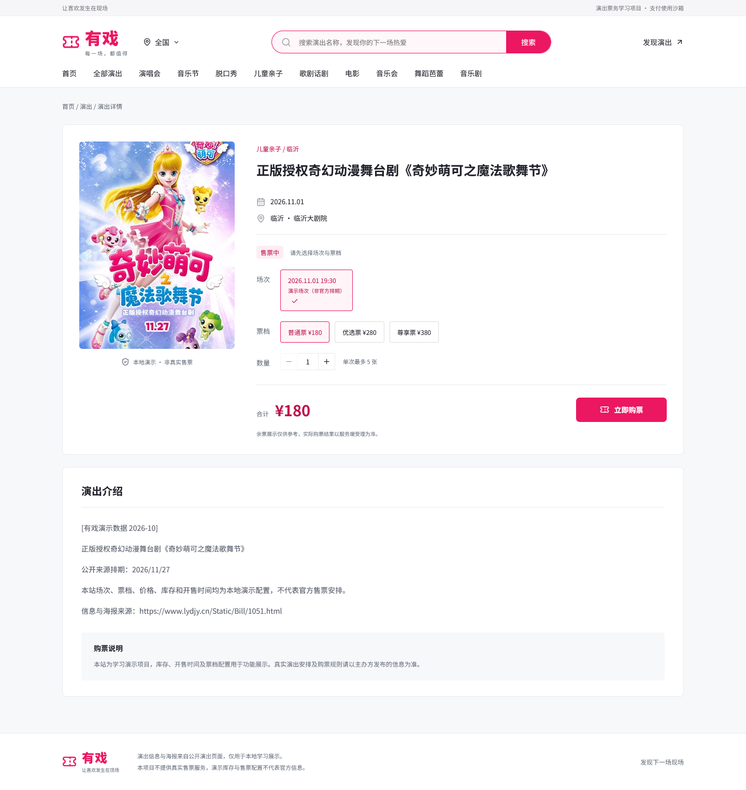

# 有戏 · 演出票务系统

「有戏」是一个可在本机运行的票务学习项目。用户可以浏览演出、选择场次和票档、提交抢票申请并查看订单；管理端负责演出上架、票档管理和交易查询。项目也演示了重复请求、取消、超时释放和迟到付款退款的处理。

## 页面演示

**以下为实际页面截图，使用演示数据。** 截图中的场次、票价、库存和开售时间仅用于展示，不是官方售票信息。演出海报来自公开页面，本项目不提供真实售票服务。

| 用户首页：浏览与分类 | 演出详情：选择场次和票档 |
| --- | --- |
|  |  |

## 本地运行

1. 准备 JDK 21、Node.js/npm 和 Docker Desktop。确认 Docker 引擎就绪。
2. 按[本地运行说明](docs/local-usable-version.md)准备本地配置，然后在仓库根目录运行 `start-local.cmd`。浏览器地址以脚本输出为准。
3. 管理端入口为 `/admin`，初始化方式见[管理端指南](docs/admin-guide.md)。结束演示时运行 `stop-local.cmd`，保留本地数据。

本地运行使用独立 MySQL、Redis、RabbitMQ，Vue 构建产物由 Spring Boot JAR 同源提供。不要在原数据库重跑初始化 SQL，也不要提交本地凭据。

## 一次抢票如何完成

1. Redisson 按用户分段协调受理，Redis Lua 原子完成预扣和限购。申请与 Outbox 落库后返回受理编号，此时订单可能尚未创建。
2. RabbitMQ 消费者异步建单，MySQL 以库存和版本条件扣减，事务内写订单和后续事件。客户端通过申请编号查询落单结果。
3. 支付以验签后的异步通知或可信渠道查询为准。取消与超时确认关单后才释放库存；渠道状态未知时保留预占，迟到付款进入退款流程。

前端：Vue 3、TypeScript、Vite。后端：Java 21、Spring Boot、MyBatis、MySQL、Redis／Redisson、RabbitMQ、Sa-Token。Flyway 用于显式迁移，Testcontainers 用于隔离验收。

## 验收与源码导读

- [交易演示清单](docs/trade-demo-checklist.md)：V11 候选同一轮 40 项交易及浏览器专项通过，JAR 构建成功。真实支付宝和 SMTP 见[沙箱记录](docs/alipay-sandbox-acceptance.md)和[邮件记录](docs/smtp-acceptance.md)。
- [P1 实测](docs/performance/p1-92dee99.md)：隔离环境单热点约 10 次/秒，三轮各五分钟，8,989 次请求全部建单，停压无积压。这是指定配置下的结果，未测得系统上限。
- [项目导读](docs/project-walkthrough.md) · [抢票协议与迁移](docs/redis-seckill-protocol.md) · [核心接口](docs/transaction-core-api.md) · [后端配置](ticket-management/README.md)

合并前的原始主分支保存在 [archive/original-main](https://github.com/Zhong128/ticketManagement/tree/archive/original-main)。
